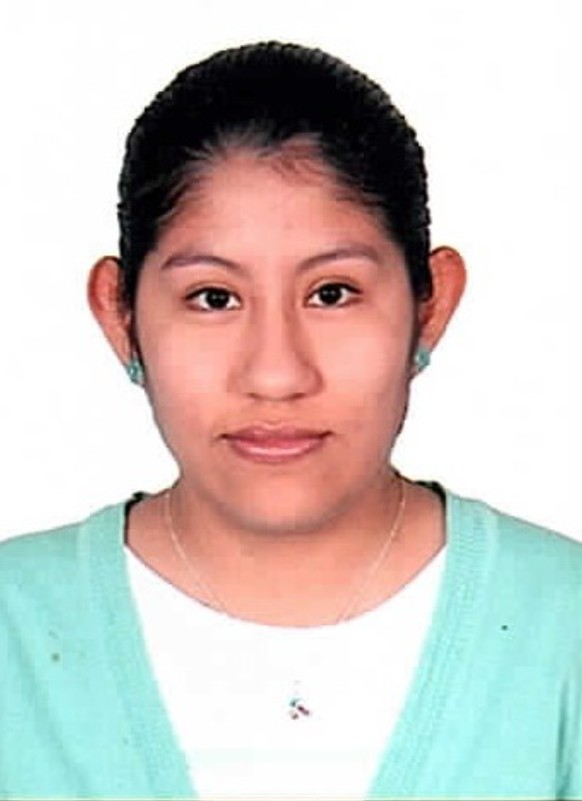
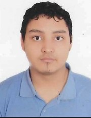

# Presentación del Grupo 5

Somos el **Grupo 5** del curso **Diseño de Modelos Fisiológicos** de la PUCP. En el **Reto 4**, estudiamos cómo la temperatura y la humedad se relacionan con la mortalidad en personas de 60 años a más en la provincia de Lima. Integramos datos de SINADEF, SENAMHI e INEI y usamos la fisiología cardiovascular y renal para orientar la interpretación.

## Integrantes y roles

| Foto | Integrante | Rol | Aporte al proyecto |
| :---: | --- | --- | --- |
|  | **Alumna 1 — Iris Lucana Macedo** | **Modelamiento fisiológico** · Fase Definir | Planteó los mecanismos que vinculan la exposición térmica con la respuesta cardiorrenal y lideró el modelamiento estadístico. |
|  | **Alumno 2 — Carlos Lembcke Vasquez** | **Datos y procesamiento** · Fase Idear | Preparó, depuró y documentó las bases de datos de mortalidad, meteorología y población para el análisis. |
|  | **Alumna 3 — Naomi Leiva Bazán** | **RSU y comunicación** · Fase Empatizar | Delimitó la población objetivo y el territorio, y comunicó la relevancia del problema para la salud pública. |
